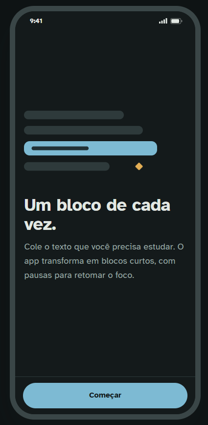
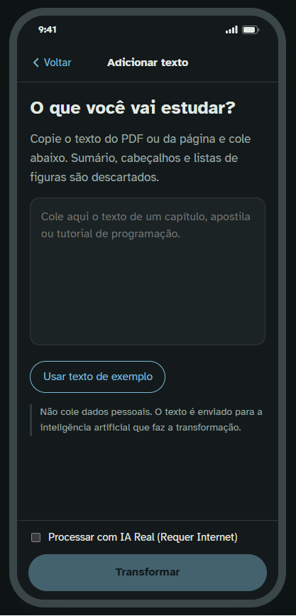
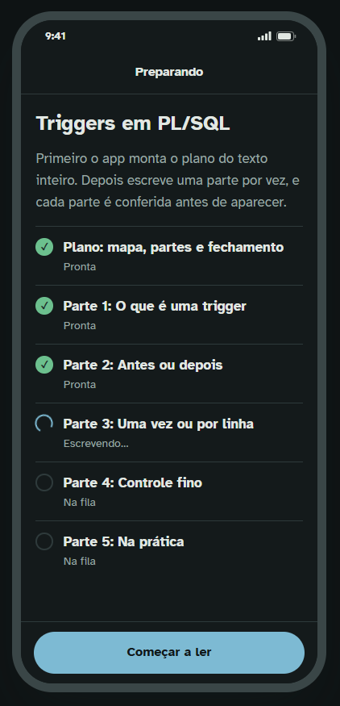
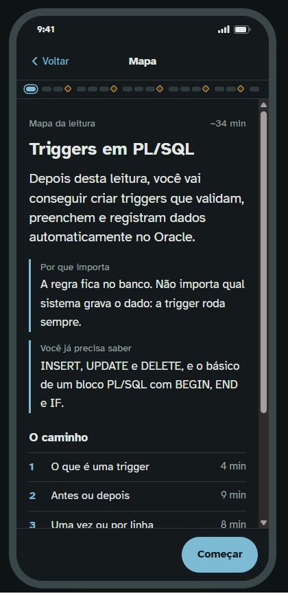
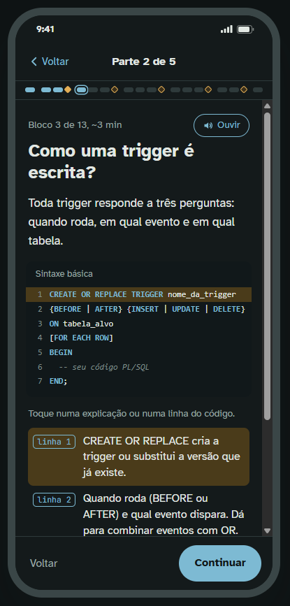
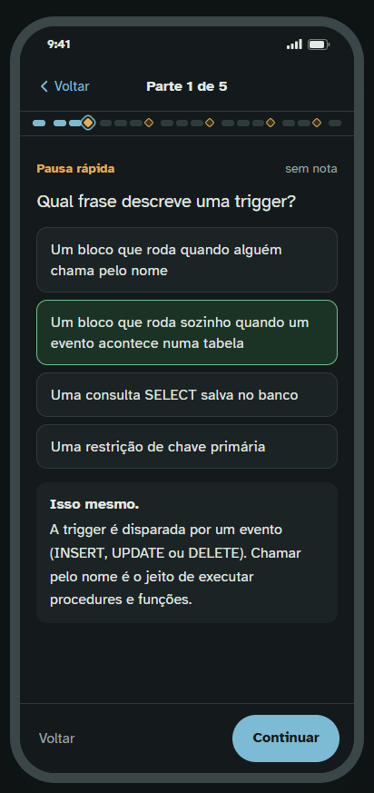

# 📱 Leitura em Foco - Acessibilidade Cognitiva (FIAP CitizenTech)

**Visão Executiva:** O *Leitura em Foco* é um aplicativo mobile desenhado para revolucionar a jornada de aprendizado de estudantes de tecnologia com TDAH (ou dificuldades de foco). Nascido do desafio **CitizenTech da FIAP**, o projeto utiliza inteligência artificial para quebrar a densidade de materiais técnicos longos, convertendo-os em trilhas de *micro-learning* interativas, garantindo retenção de conhecimento sem sobrecarga cognitiva.

🌐 **[Acesse o Protótipo Navegável do Aplicativo aqui](COLOQUE_SEU_LINK_DO_PAGES_AQUI)**

---

## 🎯 A Dor e o Desafio (O Problema)
O ecossistema de educação em tecnologia sofre com a evasão. Materiais de programação são longos, densos e misturam texto, código e capturas de tela. 
*   **O Risco:** Para estudantes com TDAH (cerca de 4,5% dos universitários brasileiros), a atenção se perde antes do fim. O resultado é o abandono da leitura, releitura sem retenção e o acúmulo de dúvidas.
*   **O Desafio:** Criar uma solução que adapte o material à forma como a pessoa consegue ler, em vez de exigir que ela se adapte a um formato único (alinhamento direto com o **ODS 4** e **ODS 10** da ONU).

---

## 💡 A Solução e Proposta de Valor
O aplicativo atua como um orquestrador de foco. O usuário insere um texto denso e a plataforma o reorganiza em blocos curtos, lidos um por tela, com pausas programadas. **O conteúdo original é mantido intacto; o que muda é a engenharia da leitura.**

### ⚙️ Funcionalidades Core (Centradas no Usuário)
*   **Foco Direcionado (Micro-learning):** O texto é fatiado em blocos de 1 a 3 minutos. O progresso é visual e constante, gerando pequenas vitórias que combatem a ansiedade.
*   **Código Interativo (Highlight Contextual):** Ao tocar em uma explicação, as linhas correspondentes do código-fonte se acendem (e vice-versa), eliminando a confusão visual.
*   **Pausas Rápidas de Fixação:** Perguntas rápidas ao fim de cada bloco para retomar a atenção e validar a retenção (sem caráter punitivo).
*   **Inclusão Omnichannel:** Suporte a leitura em voz alta (TextToSpeech) e modo 100% offline (armazenamento local).

---

## 🖥️ UX e Interface
A interface foi estruturada para garantir uma navegação *frictionless* (sem atrito), guiando o estudante de forma visual, previsível e sem sobrecarga de informações.

| **Tela Principal** | **Inserção de Texto** |
| :---: | :---: |
|  |  |
| **Preparação da Jornada (IA)** | **Mapa de Leitura** |
|  |  |
| **Código Interativo (Highlight)** | **Pausa Rápida (Fixação)** |
|  |  |

---

## 🏗️ Arquitetura e Engenharia do Sistema
A solução foi desenhada para ser robusta, escalável e aderente ao ecossistema corporativo, dividindo responsabilidades entre o cliente móvel e os serviços de backend:

*   **App Mobile (Front-end):** Kotlin com Jetpack Compose (MVVM), garantindo uma interface declarativa, fluida e nativa. Uso de *Room (SQLite)* para persistência offline e *WorkManager* para lembretes de revisão.
*   **Backend / API (Servidor):** Java 21 + Spring Boot 3 (REST API). Responsável por autenticar, montar os *prompts*, validar retornos e gerenciar o fluxo de dados.
*   **Banco de Dados:** Relacional via Oracle SQL com versionamento via *Flyway Migration*, garantindo consistência e rastreabilidade dos indicadores de impacto (textos concluídos, acertos, autoavaliação).
*   **Motor de Inteligência Artificial:** Integração via *Google Gemini API* (retornando estruturas validadas em JSON) focada exclusivamente em organizar as partes, sem alucinar ou criar conteúdos novos.

*(O protótipo interativo web hospedado neste repositório simula a jornada completa de transformação e leitura pelo ponto de vista do usuário).*
